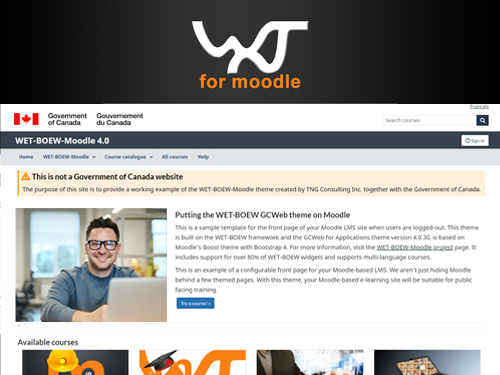

# GCWeb theme for Moodle LMS software

Web Experience Toolkit (WET), Moodle LMS variant, GCWeb theme.

## What is the Web Experience Toolkit (WET-BOEW)?

See [github.com/wet-boew/wet-boew](https://github.com/wet-boew/wet-boew)

## What is Moodle LMS?

If you are familiar with Content Management Systems (CMS) like WordPress™, Drupal™ or Joomla™, Moodle™ LMS is similar except that it is specifically designed to support education through online and in-class e-learning activities.

One of the most popular Free Open Source Software (FOSS) Learning Management Systems (LMS) in the world, Moodle LMS is a web-based application designed for those who would rather spend their time, money and efforts on developing effective e-learning courses instead of perpetual expensive monthly or yearly software licenses costing tens or even hundreds of thousands of dollars. High priorities of the Moodle project team include things like accessibility, support for multiple languages and security.

## What is the GCWeb for Moodle LMS project?

The purpose of GCWeb for Moodle LMS project on GitHub is to create an open source theme for Moodle LMS software based on version 4.0.30 of the award winning WET-BOEW framework. The initial launch featured the Government of Canada's GCWeb theme on Moodle LMS 3.9 LTS. It now includes support for Moodle 5.3 LTS. Working towards WCAG 2.2 Level AA compliance is a high priority for this project. The theme features many configurable settings for Moodle LMS administrators.

By using this theme, departments and agencies in the Government of Canada can focus their limited educational/training budgets on delivering engaging, interactive and effective sustainable educational/e-learning content instead of expensive and never ending software licenses.

## Features

* Based on the Government of Canada standard GCWeb 4.0.30 for Applications.
* Compatible with Moodle LMS 3.9, 3.10 and 3.11.
* Supports Multi-language sites.
* Highly configurable theme settings (over 85 theme settings).
* Configurable course listings (thousands of potential variations).
* Hide local login (useful for sites integrated with OAuth2 or SAML SSO).
* Display only the desired user profile fields and hide the rest.
* Configurable page header and footer.
* Display alert/notification messages site-wide in 4 different styles.
* Configurable navigation drawer settings.

## What's new?

* We have completed initial development and specification design.
* The theme is now compatible with Moodle LMS 3.9, 3.10 and 3.11.
* The theme now supports H5P activity content types and the H5P Content Bank.
* Corrected some display issues on the Dashboard, Feedback activity, page footer and in the menu in mobile view.
* Addressed several reported accessibility issues.
* Dropped support for Internet Explorer (IE) 11. Added alert message for these users.

TODO list:

* Ongoing quality assurance and WCAG 2.2 level AA testing (and fixing).
* Code cleanup.
* Update documentation.
* Develop the next version compatible with Moodle LMS 5.3.

## Interested in this project?

Let us know by [dropping us a note](https://github.com/michael-milette/moodle-theme_gcweb/issues/1). We believe in creating sustainable solutions for our clients by developing strong peer e-learning communities.

We are looking for volunteers and financial support to continue development, functional testing, language testing, accessibility testing and RTL testing.

We would especially love to hear from you if you are:
* Currently or planning on using Moodle LMS within the Government of Canada or in the private sector;
* A developer with Moodle LMS (or extensive PHP) experience who might like to contribute to this project.

Ideas, suggestions or code to share? Please [create a new separate issue](https://github.com/michael-milette/moodle-theme_gcweb/issues/) for each one.

## Why should I contribute?

There is a wasteful situation going on in this world, the duplication of time, money and effort. This is severely limiting creativity, innovation and evolution each time someone has to re-create the wheel.

By contributing your ideas, you may see them get implemented and supported in future releases. Contributed code has a chance of being integrated into future releases of GCWeb for Moodle LMS as well. Together with the modular nature of Moodle LMS, this makes it a lot easier to upgrade when new releases of GCWeb and Moodle LMS become available.

If you are part of Government, education or other large corporations, you can save money by avoiding duplicate spending on development to achieve similar results. As an individual developer, you also get recognition for your contribution efforts.

## System Requirements

For accessibility reasons, GCWeb for Moodle LMS is only compatible with [Moodle LMS 3.9 LTS](https://docs.moodle.org/dev/Moodle_3.9_release_notes#Server_requirements), [3.10](https://docs.moodle.org/dev/Moodle_3.10_release_notes#Server_requirements) and [3.11](https://docs.moodle.org/dev/Moodle_3.11_release_notes#Server_requirements). An upcoming release will be available for Moodle LMS 5.3 LTS. It has the same Web server, database and web browser requirements which can be found on Moodle.org. Support for other newer versions of Moodle LMS may be added at a later date depending on the level of interest.

Note: The GCWeb for Moodle LMS theme includes web based mobile support on iOS and Android devices.

These specifications and requirements may change as development progresses.

## Documentation

Any provided documentation will eventually be available in [the project's Wiki](https://github.com/michael-milette/moodle-theme_gcweb/wiki). This will include:
* Changelog
* Installation
* Theme configuration
* Updating GCWeb for Moodle LMS
* Uninstallation

## Have Ideas? Need support? Reporting a bug?

To propose ideas, report a bug or request support, please [create individual](https://github.com/michael-milette/moodle-theme_gcweb/issues). Keep in mind that support for this project is provided on a voluntary basis and is therefore limited by availability and willingness of volunteers to contribute their time and effort. We are open to, encourage and appreciate pull requests and support in responding to people's questions.

## Acknowledgements

This project is made possible through the combined efforts of many people including:
* Project Author/Lead Developer, @michaelmilette with support of [TNG Consulting Inc.](https://www.tngconsulting.ca/)
* Government of Canada - the Department of Innovation, Science and Economic Development Canada
* Government of Canada - the Department of Indigenous Services Canada
* Other [project contributors](https://github.com/michael-milette/moodle-theme_gcweb/graphs/contributors)

It is also made possible thanks to the efforts of hundreds of contributors to related open source projects including:
* [WET-BOEW framework project](https://github.com/wet-boew/wet-boew/)
* [Moodle](https://www.moodle.org/)

If you would like to contribute your time, effort or contribute financially to this project in order to accelerate its development, please contact @michaelmilette.

The working examples demo site and the space on GitHub for the GCWeb for Moodle LMS project software is sponsored and maintained by TNG Consulting Inc.

## Limitations

* The theme has limited support for WET-BOEW widgets. To see the current state of WET-BOEW widget compatibility, download and install the [WET-BOEW-GCWeb widgets](https://github.com/michael-milette/wet-boew-moodle-widgets) course in your instance of Moodle LMS configured with a GCWeb theme.
* Accessibility is a high priority for the GCWeb for Moodle LMS project. However it is not perfect yet.
* This project does not attempt to correct accessibility issues which may exist in Moodle LMS core code. In order to create a site that is WCAG 2.2 Level AA compliant, you may also need to address accessibility issues in Moodle LMS itself. Please consider reporting Moodle LMS core issues in the [Moodle tracker](https://moodle.atlassian.net/jira/projects) - and contribute fixes if you can.
* This theme may not be compatible with RTL languages.
* The theme does not support IE 11.

## License

Unless otherwise noted, the overall GCWeb for Moodle LMS project, wiki content, documentation and source code is Copyright © 2016 onwards by [TNG Consulting Inc.](http://www.tngconsulting.ca/) Inc. with parts which may be contributed/copyrighted by others. GCWeb for Moodle LMS is provided freely as open source software, can be redistributed and/or modified it under the terms of the [GNU General Public License version 3.0 or later](https://github.com/michael-milette/moodle-theme_gcweb/blob/master/LICENSE.txt).

It is distributed in the hope that it will be useful. However, **there is no warranty**, implied or otherwise, of merchantability or fitness for any purpose. See the GNU General Public License for details.

If for any reason a copy of the GNU General Public License was not included with this project, you can view it online by going to:
https://www.gnu.org/licenses/gpl-3.0.en.html

## Further information

For further information regarding the GCWeb for Moodle LMS project, please contact Michael Milette at [TNG Consulting Inc.](https://www.tngconsulting.ca/contact) or via [LinkedIn](https://www.linkedin.com/in/michaelmilette).
